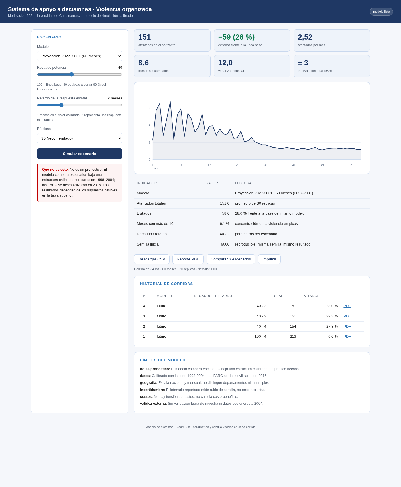

# DSS — Sistema de apoyo a decisiones

Capa de software sobre el modelo de simulación: una API que ejecuta escenarios y un panel web
que los compara. Cubre el **incremento 1** y parte del 2 de la bitácora (`04_futuro`):
persistencia, comparación múltiple, reporte PDF y validación de datos.

Riesgos y mitigaciones: [`RIESGOS.md`](RIESGOS.md).



## Qué hace

- Ejecuta escenarios sobre **dos modelos**: calibrado 1998–2004 (84 meses) y proyección
  2027–2031 (60 meses).
- Cambia dos parámetros: recaudo potencial (financiamiento) y retardo de la respuesta estatal.
- Corre N réplicas con semilla fija y devuelve media, varianza, meses en calma, picos e
  intervalo del 95 %.
- Compara contra la línea base del mismo modelo y calcula atentados evitados.
- Exporta CSV e imprime a PDF desde el navegador.

## Requisitos

- Python 3.10 o superior.
- Los modelos del repositorio: `02_informe/modelo_farc.py` y `04_futuro/modelo_futuro.py`.

## Instalación

```bash
cd 06_software
python -m venv .venv
source .venv/bin/activate
pip install -r requirements.txt
```

## Ejecución

```bash
./run.sh
# o bien:
uvicorn app.main:app --host 127.0.0.1 --port 8000
```

Abrir `http://127.0.0.1:8000`. El panel simula el escenario base al cargar.

Parámetros por URL: `?modelo=futuro&rec=40&tau=2&rep=30`.

## API

| Método | Ruta | Descripción |
|---|---|---|
| GET | `/api/salud` | Estado, versión y concurrencia |
| GET | `/api/modelos` | Metadatos y valores base de cada modelo |
| GET | `/api/limites` | Límites y supuestos del modelo |
| POST | `/api/simular` | Ejecuta un escenario y lo guarda |
| POST | `/api/comparar` | Ejecuta 2–5 escenarios y los guarda |
| GET | `/api/historial` | Últimas corridas |
| GET | `/api/historial/{id}` | Detalle de una corrida |
| GET | `/api/historial/{id}/pdf` | Reporte PDF de una página |
| POST | `/api/datos/validar` | Valida un CSV de serie mensual antes de recalibrar |

Clave opcional: si se define `DSS_API_KEY`, todos los endpoints de cálculo e historial exigen
el header `X-API-Key`.

Ejemplo:

```bash
curl -X POST http://127.0.0.1:8000/api/simular \
  -H 'Content-Type: application/json' \
  -d '{"modelo":"futuro","recaudo":40,"retardo":2,"replicas":30}'
```

Respuesta (resumida):

```json
{"total":151.0,"media_mensual":2.52,"varianza_mensual":11.99,
 "meses_sin_atentados":8.6,"p_mas_10":6.1,"ic95":3.3,
 "evitados":58.6,"evitados_pct":28.0,"meses":60}
```

## Pruebas

```bash
python -m pytest tests -q     # 16 pruebas
./scripts/smoke.sh            # humo: API, simulación, PDF y límites
```

## Criterios de aceptación cumplidos

| Criterio | Umbral | Resultado |
|---|---|---|
| Reproducir la base (futuro) | 211 atentados | 209,6 con 30 réplicas |
| Reproducir la base (calibrado) | 290,0 atentados | 289,9 con 30 réplicas |
| Latencia por escenario | < 60 s | 31–208 ms |
| Error frente al modelo Python | < 1 % en la media | 0,7 % |
| Trazabilidad | semilla y parámetros visibles | sí, en respuesta, panel y PDF |
| Comparación múltiple | 2–5 escenarios por petición | 3 escenarios en 0,6 s |
| Persistencia | historial recuperable | SQLite en WAL, probado |

## Despliegue con Docker

```bash
docker compose -f 06_software/docker-compose.yml up --build
```

La imagen usa `python:3.12-slim`, corre como usuario sin privilegios, guarda la base en el
volumen `dss_datos` y expone un `HEALTHCHECK` contra `/api/salud`.

No verificado: el daemon de Docker no estaba disponible en la máquina de desarrollo, así que la
imagen no se construyó. El humo se validó sin contenedor.

## Límites declarados (también en `/api/limites`)

- No es un pronóstico: compara escenarios bajo una estructura calibrada.
- Sin validación fuera de muestra: el ETL existe, la recalibración no se hizo.
- Autenticación por clave compartida, sin roles.
- Concurrencia limitada por semáforo en un proceso; para más carga, varios contenedores.
- La línea base se cachea por modelo y número de réplicas, con semillas fijas.

## Siguiente fase

ETL contra fuentes oficiales (hoy valida CSV), cola de tareas distribuida, usuarios y roles,
validación con una serie posterior a 2004 (semanas 8–12 de la bitácora).
